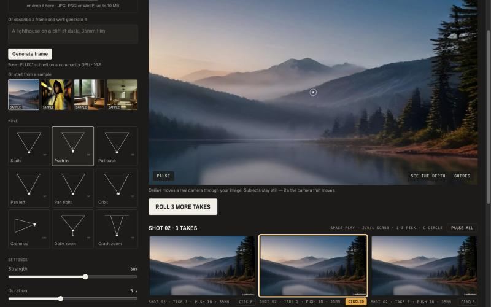

# Dailies

**A real camera for your still images.** Live: **https://higgsfield-rebuild-cyan.vercel.app** — free, no sign-in.

Photo in, real camera move out. Pick a move, roll 3 versions, keep the best, download a 1080p MP4. Everything runs in your browser; nothing costs credits.

**The signature touch: the witness cam.** Moves are math, not generation, so Dailies can show you the camera itself. In the corner of the Explore hero (and on the Studio preview with **W**) a second camera films the shot camera, a lime frustum, flying through your photo's 3D relief along the move you chose. A generated video has no camera to show. Chosen by a five-advisor council ([verdict](docs/council/2026-10-29-signature-touch.md)).

**Product film (30 s).** [`docs/film/dailies-30s.mp4`](docs/film/dailies-30s.mp4), or play it live at [/film](https://higgsfield-rebuild-cyan.vercel.app/film). Every camera shot in it is rendered by Dailies' own renderer and witness cam, and the MP4 is encoded in the browser like a take export ([brief](docs/film/BRIEF.md); colours, copy and timings in `src/film/config.ts`).

**Rack focus.** Every take pulls focus from the background onto your subject, using the photo's own depth: in the preview, the takes and the exported MP4. On by default; tap the preview to choose the subject, or switch it off in Settings ([why this feature](docs/council/2026-10-29-next-feature.md)).

**Sections:** [Explore](https://higgsfield-rebuild-cyan.vercel.app/explore) (the tour) · [Studio](https://higgsfield-rebuild-cyan.vercel.app/) (frame → move → takes → MP4) · [Frames](https://higgsfield-rebuild-cyan.vercel.app/frames) (text to frame on a free GPU) · [Moves](https://higgsfield-rebuild-cyan.vercel.app/moves) (the nine moves, by kind) · [Dailies](https://higgsfield-rebuild-cyan.vercel.app/dailies) (your history) · [Pricing](https://higgsfield-rebuild-cyan.vercel.app/pricing) (free, and why). The same jobs Higgsfield splits into Explore, Image, Video, presets, History and Pricing, in Dailies' own look ([why not a copy](docs/superpowers/specs/2026-10-29-platform-breadth.md)).

## Try it in 60 seconds

1. Open the link. A sample frame is already moving (a push-in). No model download is needed for the samples.
2. Drop in your own JPG/PNG/WebP, or type a frame description and press **Generate frame**. The first photo of a visit downloads the depth model once (50 MB with WebGPU, 27 MB without) and shows its progress.
3. Pick a move from the strip of diagrams (try **Dolly zoom**). It previews on your frame at once.
4. Press **Roll 3 takes**. Three slightly different takes play side by side.
5. Tap a take (or press **1**, **2**, **3**), **Circle** it to keep it, then **Export MP4**. The file downloads. Your shots stay in **Dailies**.

## Tested on, and known limits

| Where | Status | Notes |
|---|---|---|
| Chrome / Chromium, desktop (WebGPU) | Tested | Whole loop on production, signed out. Your own photo to a moving camera: 4.1 s on a cold cache over a fast connection (about 1.3 s of it is the 50 MB model download). On a ~10 Mbit/s connection, expect 20–40 s the first time, with a progress line |
| Chromium at phone width (375 px) | Tested | Roll bar pinned at the bottom; after Roll the page scrolls to the takes; a tapped take's Export panel scrolls into view |
| Free GPU services down (FLUX frames, AI variation) | Tested | Drill with Hugging Face hosts blocked: frame generation says so and offers **Upload an image** / **Use a sample**; the AI variation says "Community GPU is busy — your take is safe"; sample → roll → circle → export still produced a 1080p MP4 |
| Safari (macOS, iOS) | Not tested by hand | Code paths: WASM depth where WebGPU is missing, WebCodecs export from Safari 16.4 (DOM canvas on 16.4–16.6), WebM where H.264 encoding is missing |
| Firefox | Not tested by hand | WASM depth (about 5 s per frame); export falls back to WebM via MediaRecorder |
| A real phone | Not tested by hand | Mobile browsers can drop WebGL contexts under memory pressure; players then show "Click or tap to reload" |

## What Higgsfield charges ✦80 for, what Dailies does free, and why I stopped there

From a free signed-in Higgsfield account on 29 Oct ([addendum](docs/recon/05-logged-in-addendum.md), screens 17–22 in [`recon/screens/`](recon/screens/)):

| | Higgsfield | Dailies |
|---|---|---|
| A camera move | One of "250+ presets for camera control, framing and VFX", picked as a card, then generated by a video model | One of 9 moves, each a camera path you see on your own frame before anything renders |
| What a try costs | ✦80 credits for a 5 s 1080p clip. The Plus card says 1,200 credits ≈ 80 videos; at those settings it buys 15 | Nothing. Roll as many takes and export as many MP4s as you like |
| When you learn the price | After writing a prompt and pressing Generate: a paywall with a countdown | Never: no account, no credits, no gate |
| What it can do that Dailies can't | Subjects move, new content appears, 30+ models | The camera moves, the subject doesn't. The optional AI variation is the bridge, on a free GPU that may say no |

**Why I stopped there.** Dailies keeps Higgsfield's real moat, curated camera motion, and removes what its users complain about: paying and waiting for every try, and not seeing the move first. I left out the parts that exist to sell credits (the preset vending grid, credit counters, free-gens badges, countdowns, the paywall) and the parts that are commodity or off-thesis (the model catalogue, characters, MCP, a community feed). In the last hours a five-advisor review weighed one more feature (a multi-take reel export) against hardening what graders touch first; hardening won ([DECISIONS.md](DECISIONS.md)).



**Frame → Move → Roll takes → Review side by side → Circle the best → Export MP4.**

Dailies is an 8x take-home that rebuilds [Higgsfield](https://higgsfield.ai) around its clearest differentiator, camera motion on your own image, and fixes the part users complain about most: paying and waiting for every try. (Users praise the model catalogue and output quality more; camera control ranks third, see [voice of user](docs/recon/02-voice-of-user.md).) The bet: for a solo creator who needs a camera move on a still, an exact move that previews instantly, re-rolls for free and exports deterministically beats a generative clip that costs credits and minutes per try. On Higgsfield a "camera move" is a word handed to a video model: you pay, wait minutes and hope. In Dailies the camera is real. Your frame gets an AI depth map, becomes a 2.5D scene, and the move is rendered exactly as chosen, in your browser, instantly, as often as you like, for free.

## What it is and why

- Research first: [product teardown, voice of the user, stack feasibility, the median rebuild](docs/recon/README.md), with the screens in [`recon/screens/`](recon/screens/). Signed-in screens were added after the build, on 29 Oct, as a dated [addendum](docs/recon/05-logged-in-addendum.md).
- Every call, with its evidence and cost: [DECISIONS.md](DECISIONS.md). Design: [spec](docs/superpowers/specs/2026-10-28-dailies-design.md). Plan: [plan](docs/superpowers/plans/2026-10-28-dailies.md). Spikes: [docs/spikes.md](docs/spikes.md).
- Higgsfield's moat is curated motion, not its 30-model catalogue. Dailies keeps the motion, makes it exact and free, and borrows the film set's way of working: shoot several takes, keep one.

## What is real, what is experimental, what is cut

| | What | How |
|---|---|---|
| **Real** | AI frames from text | FLUX.1 [schnell] on Hugging Face's free community GPUs, called from your browser |
| **Real** | AI depth | Depth Anything V2 (small) in a Web Worker: WebGPU, or WASM where WebGPU is missing |
| **Real** | Exact camera moves | 9 moves (push in, pull back, pan left/right, orbit, crane up, dolly zoom, crash zoom, handheld static), each a deterministic function of the take's recipe and seed |
| **Real** | MP4 export | The take is re-rendered offline frame by frame and encoded with WebCodecs H.264 + mp4-muxer; WebM via MediaRecorder where H.264 encoding is missing |
| **Real** | History | Shots, takes (as recipes), frames and depth maps in your browser's IndexedDB; survives refreshes and return visits |
| **Experimental** | Print an AI variation | A circled take's frame and move (in words; not its lens, strength, easing or duration) sent to Wan 2.2 image-to-video on a free community GPU. May queue or be unavailable; labelled so |
| **Cut** | Paid generation, accounts, credits | Zero spend by design ([DECISIONS.md](DECISIONS.md)) |
| **Cut** | Pollinations for frames | It refuses browser calls without a Turnstile token and rate-limits Vercel's shared IPs ([spikes](docs/spikes.md#addendum-task-10-1350-utc--pollinations-from-a-real-browser-page)). The four sample frames were made with it before that was known, so they carry its small logo |
| **Cut** | Model catalogue, community feed, characters, audio, VFX apps | Not the moat ([recon](docs/recon/01-product-teardown.md)) |
| **Later (P1)** | Reel export, frame edit, share links | Only after QA passed; not started |

## Honest limits

- A 2.5D move animates the camera, not the subject. People don't walk, water doesn't flow. The UI says so next to the preview.
- Big moves reveal the edges of the frame, so each move's strength is capped where the edges stayed clean in testing (orbit and pans have the tightest caps).
- The free community GPU gives each visitor a small anonymous quota (a few frames). When it runs out the app says so; uploading always works.
- Depth without WebGPU (Firefox, older Safari) takes about 5 s per frame instead of about 0.15 s.
- Everything lives on one device. Clearing site data, or another browser, starts empty.

## Architecture

```
Browser (everything that matters)                                  Vercel: static Next.js 16 app, no server code
┌──────────────────────────────────────────────────────────────┐
│ Frame ── upload / sample / FLUX.1 schnell (HF ZeroGPU, @gradio/client)
│   │  validate (JPG/PNG/WebP ≤ 10 MB) → downscale ≤ 1536 px → sha-256 id
│   ▼
│ Depth worker ── Depth Anything V2 small (transformers.js, WebGPU fp16 | WASM q8)
│   │  normalise, 3×3 blur → DepthMap (cached in memory + IndexedDB)
│   ▼
│ Scene (three.js) ── 256² plane, vertices pushed back along the base camera's rays
│   │  poseAt(move, params, t, seed) → camera   ← the take's recipe
│   ├─► Preview / takes grid (synced players, rAF)
│   └─► Export: same scene, offline, frame by frame → VideoEncoder → mp4-muxer → .mp4
│ Store ── IndexedDB (idb-keyval): frames, depth, shots + takes, draft
│ Print (experimental) ── Wan 2.2 i2v on HF ZeroGPU via @gradio/client
└──────────────────────────────────────────────────────────────┘
```

## Local setup

```bash
npm i && npm run dev
```

No environment variables, no keys. Open http://localhost:3000.

## Tests

```bash
npx vitest run
```

The pure parts are pinned by tests: camera poses and framing (`moves`), take variation and shot rules (`takes`, `studio`), frame validation and sizing (`frame`), depth post-processing and the sample depth assets (`depth`, `depth-asset`), the renderer's letterbox maths and camera mapping (`scene`), export paths, sizes and single-flight (`export`), storage round-trips with `fake-indexeddb` (`store`), frame generation and the print client against fake Gradio clients (`framegen`, `print`), and the rate limiter. QA by hand is in [docs/QA.md](docs/QA.md).

## Capture evidence

Every prompt and final response of the build sessions is logged automatically by Claude Code hooks into [`.agent-logs/`](.agent-logs/) and committed with the code it produced. How it works, and the two canary runs: [CAPTURE-TEST.md](CAPTURE-TEST.md).
